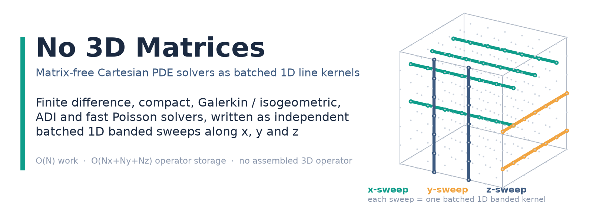
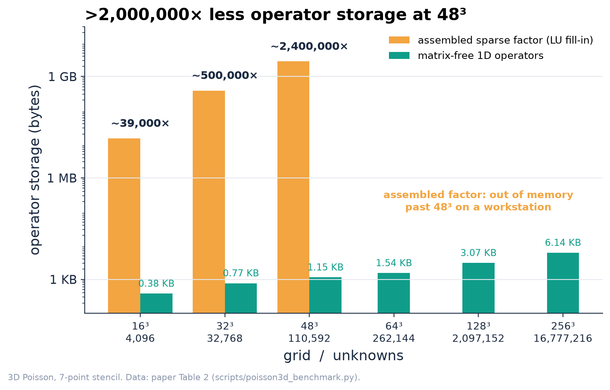
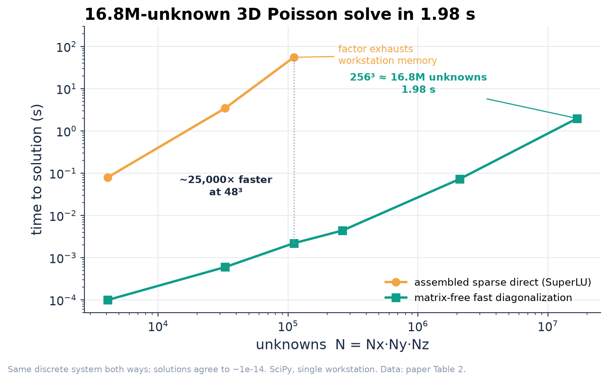
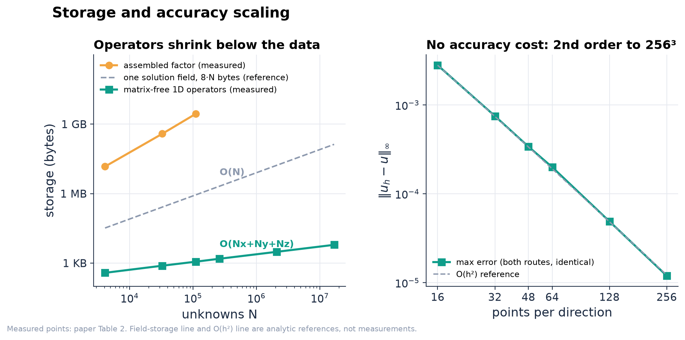
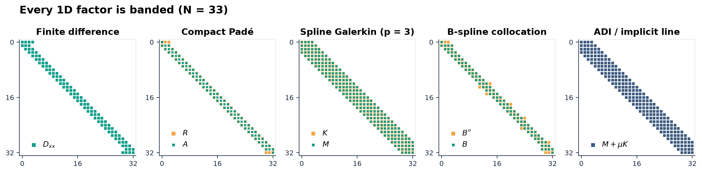

<p align="center">
  
</p>

# No 3D Matrices

[](https://arxiv.org/abs/2606.25148)
[](https://arxiv.org/abs/2606.25148)
[](LICENSE)
[](paper/LICENSE)
[](scripts/)

Source and reproducibility code for the paper

**No 3D Matrices: A Unified Tensor-Product View of Matrix-Free Cartesian PDE Solvers**
Yong Yi Bay and Kathleen A. Yearick
Preprint: [arXiv:2606.25148](https://arxiv.org/abs/2606.25148) (math.NA)

## Overview

On a tensor-product Cartesian grid, the standard high-order PDE discretizations
(finite differences, compact Padé schemes, Galerkin finite element, B-spline and
isogeometric methods, collocation, ADI time stepping, and fast Poisson/Helmholtz
solvers) factor along the coordinate axes into one-dimensional banded line
operations, exactly for separable operators. The three-dimensional operator is
never assembled, factored, or stored: every sweep is a batch of independent,
synchronization-free 1D line kernels. The paper derives that reduction with
Kronecker-product algebra, states where it is exact, and shows how production
codes turn it into hardware-efficient kernels: batched line solves, BLAS-3 GEMM,
sum factorization, and MPI pencil decomposition.

For fixed stencil width or polynomial degree, a derivative sweep or factorized
line solve costs O(N) arithmetic in the number of unknowns N = Nx·Ny·Nz, and the
operator storage is O(Nx + Ny + Nz) up to bandwidth constants. Separable direct
Poisson and Helmholtz solves add the transform cost, O(N log N_max) with FFT-type
bases. In a 3D Poisson benchmark the matrix-free solver handles 256³ (16.8M
unknowns) in 1.98 s on CPU with 6.14 KB of operator data. At 48³ its operator
storage is more than 2,000,000x smaller than the assembled sparse LU factor.

## Results

The benchmark (`scripts/poisson3d_benchmark.py`, Table 2 of the paper) is
verification by a manufactured solution: −∇²u = g on the unit cube,
homogeneous Dirichlet boundaries, manufactured solution
u = sin(πx) sin(πy) sin(πz), seven-point stencil on an N×N×N interior grid. The
same discrete system is solved two ways: (A) assemble the N³×N³ sparse Laplacian
and factor it with a sparse direct solver (SuperLU via SciPy), and (B) matrix-free
fast diagonalization (a sine transform per axis, a pointwise division by the
summed 1D eigenvalues, an inverse transform). Both routes return the same
discrete solution to about 1e-14.

| Metric | Assembled sparse direct | Matrix-free (1D factors only) |
|---|---|---|
| Operator storage at 48³ (110,592 unknowns) | 2,799 MB (LU fill-in) | 1.15 KB (ratio above 2,000,000) |
| Solve time at 48³ | 55.4 s | 0.0022 s |
| Largest grid solved | 48³ (memory-bound beyond) | 256³ = 16,777,216 unknowns |
| Solve time at 256³ | out of memory | 1.98 s |
| Operator storage at 256³ | n/a | 6.14 KB |
| Max error ‖u_h − u‖∞ at 256³ | n/a | 1.2e-5 (second order) |
| Agreement between routes | | about 1e-14 |

<p align="center"></p>

**Figure 1.** Operator memory footprint on a log scale. The assembled sparse
factor grows from 14.8 MB (16³) to 2,799 MB (48³) and runs out of memory past
48³. The matrix-free operator is the three sets of 1D eigenvalues: 0.38 KB at
16³ and 6.14 KB at 256³.

<p align="center"></p>

**Figure 2.** Time to solution versus unknowns. At 48³ the assembled direct solve
takes 55.4 s and the matrix-free solve 0.0022 s. The matrix-free route continues
to 256³ (16.8M unknowns) in 1.98 s.

<p align="center"></p>

**Figure 3.** Left: storage versus unknowns. Measured operator storage of the
matrix-free solver grows as O(Nx + Ny + Nz) and stays several orders of magnitude
below a single double-precision solution field (8N bytes, drawn as an analytic
reference). Right: max-norm error of the shared discrete solution against the
manufactured solution, with an O(h²) reference line. Removing the 3D matrix
changes storage and time, not accuracy.

<p align="center"></p>

**Figure 4.** Sparsity of the 1D factors (N = 33) for each discretization family
covered in the paper: centered second difference D_xx, compact Padé maps A and R,
cubic spline Galerkin mass M and stiffness K, B-spline collocation maps B and B'',
and the implicit line factor M + μK used in an ADI substep. Every factor is
banded. Matrices are built with the constructors in
`scripts/make_sparsity_figures.py`.

## Method

The 3D Laplacian on a tensor-product grid is a Kronecker sum of three 1D
operators,

```
L = I_z ⊗ I_y ⊗ D_xx  +  I_z ⊗ D_yy ⊗ I_x  +  D_zz ⊗ I_y ⊗ I_x
```

so applying L is three sweeps over the families of grid lines, each sweep a batch
of independent banded matvecs. The same structure covers the operators below.

| Task | Tensor-product form | How it runs |
|---|---|---|
| Finite-difference derivative | I_z ⊗ I_y ⊗ D_x and relabelings | independent banded line applies, O(N) |
| Compact (Padé) derivative | (I ⊗ I ⊗ A_x) v = (I ⊗ I ⊗ R_x) u | banded right-hand side plus banded line solve |
| Galerkin / B-spline / isogeometric mass inverse | (M_z ⊗ M_y ⊗ M_x)⁻¹ | three families of 1D banded mass solves |
| B-spline collocation | banded nodal maps B, B′, B″ per axis | factorized line applies (no formed B″B⁻¹) |
| ADI substep | I − r (I_z ⊗ I_y ⊗ D_xx) | one directional batch of tridiagonal or banded solves |
| Fast Poisson / Helmholtz | diagonalized Kronecker sum | transform per axis, pointwise division, inverse transform |

The reduction is exact for uniform, non-uniform, and stretched Cartesian grids,
mixed boundary conditions, tensor-product Galerkin and spline bases, and
separable variable coefficients. With general variable coefficients or
non-separable curvilinear metrics, the separable part remains a fast split
operator or preconditioner (for example inside a preconditioned Krylov solver),
and tensor-product elements and patches keep the same kernels locally on
unstructured meshes.

Three implementation techniques make the reduction fast on real hardware
(Section 11 of the paper):

1. **Multi-right-hand-side reshape.** Reshape the field to
   U ∈ R^(Nx × Ny·Nz) so the x-lines are columns, then apply D_x to all columns
   in one call. When the 1D factor is dense or element-local this is a BLAS-3
   GEMM. When it is banded it is a batched banded or tridiagonal kernel, the
   shape served by batched GPU solvers. y- and z-sweeps use a transpose to bring
   the active direction to the contiguous axis.
2. **Sum factorization.** High-order Galerkin quadrature on one element drops
   from O(n^(2d)) to O(d·n^(d+1)) by contracting one index at a time, a speedup of
   about n²/3: roughly 27× at p = 8 and 96× at p = 16.
3. **Pencil decomposition.** MPI ranks sit on a 2D process grid so each rank
   holds complete lines in one direction. An all-to-all transpose rotates the
   pencil orientation before each sweep, so every 1D kernel runs on local,
   contiguous data. A three-direction sweep needs two transposes.

The line kernels within a sweep are independent, so they run as synchronization-free
batched line sweeps and fit cache and GPU memory hierarchies. The O(N) work and
O(Nx + Ny + Nz) operator storage give a concrete baseline for evaluating
matrix-free, low-rank, and learned solvers.

## Reproducing

### Build the paper

```bash
./build_paper.sh
```

Requires a TeX distribution with `latexmk`, `pdflatex`, and `bibtex` (`bibtex8`
is used when available). The output is `paper/main.pdf`.

### Figures and the benchmark

The scripts declare their own dependencies (inline script metadata: matplotlib,
NumPy, SciPy) and run with [uv](https://docs.astral.sh/uv/):

```bash
uv run scripts/make_sparsity_figures.py   # operator sparsity figures
uv run scripts/poisson3d_benchmark.py     # 3D Poisson benchmark (Table 2 + Figure 13)
```

Both write their PDFs into `paper/figures/`. The benchmark prints the full table
(fill-in, timings, errors, storage and time ratios) to stdout and asserts that
the two routes agree to better than 1e-9 at every size where both run. Timings
depend on the machine; storage and error columns do not.

### Layout

```
paper/           LaTeX source, bibliography, and figures (self-contained arXiv submission)
scripts/         Python scripts that regenerate the figures and the benchmark
assets/          Figures used in this README
build_paper.sh   Reproducible build with latexmk
```

## Citation

```bibtex
@article{bay2026no3d,
  title         = {No 3D Matrices: A Unified Tensor-Product View of Matrix-Free Cartesian PDE Solvers},
  author        = {Bay, Yong Yi and Yearick, Kathleen A.},
  year          = {2026},
  eprint        = {2606.25148},
  archivePrefix = {arXiv},
  primaryClass  = {math.NA}
}
```

A `CITATION.cff` file is included for GitHub's "Cite this repository" button.

## License

The source code (`scripts/`, `build_paper.sh`) is released under the MIT License
(`LICENSE`). The paper text and figures (`paper/`) are licensed under CC BY 4.0
(`paper/LICENSE`).
